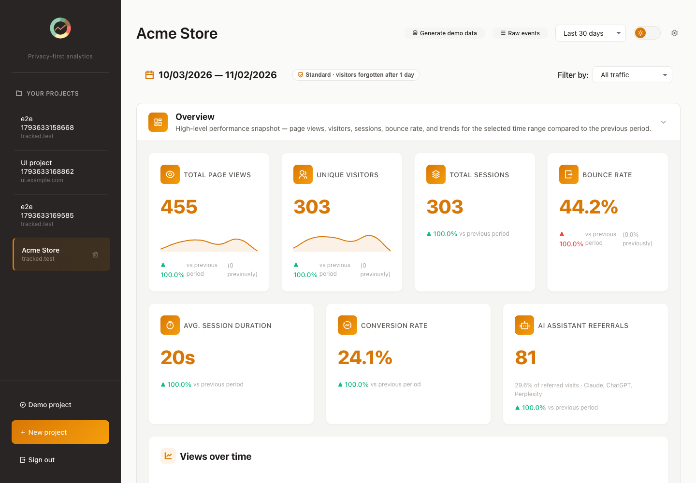
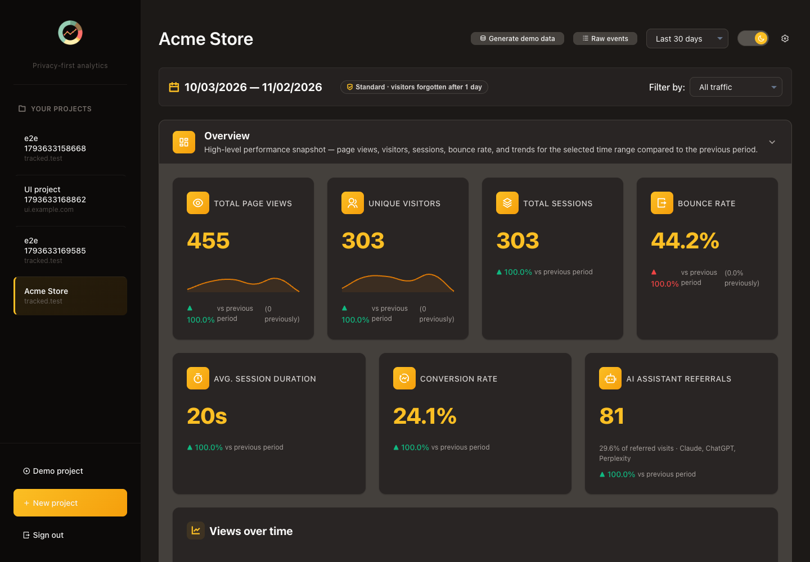
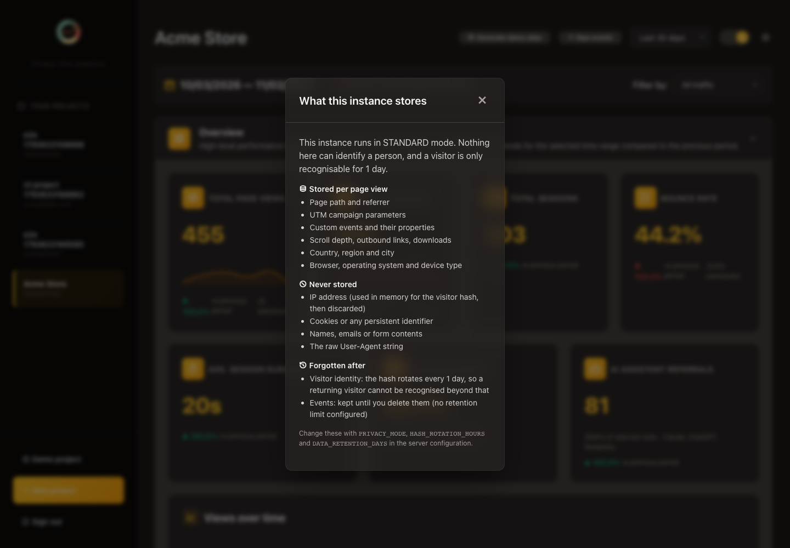

<p>
  
  
  
  
</p>

# Mini Numbers

**Website analytics you run yourself.** See which pages people read, where they come from and what they do —
without cookies, without storing IP addresses, and without handing data to anyone.

<p align="center">
  
</p>
<p align="center">
  
  
</p>

## Why Mini Numbers

- **One program, nothing else to run.** A single JAR or Docker image with SQLite built in — no ClickHouse,
  Redis or separate database server.
- **Privacy you can tune.** Three privacy modes and an adjustable "forget visitors after" window (1 hour to
  1 year). The dashboard shows exactly what your server stores, and browsers that send Global Privacy Control or
  Do Not Track aren't counted.
- **Everything included.** Goals, AI-assistant referrals, CSV export and a REST API — no paid tier, no feature
  held back from self-hosters. Funnels, segments, revenue, webhooks, email reports and widgets are in
  [labs](docs/configuration.md#labs): switch them on with one setting while they mature.
- **Small tracker.** About 2 KB gzipped, no cookies, works with single-page apps.
- **MIT licensed.**

How it stacks up against Plausible, Umami, Matomo, Liwan and others: **[comparison](docs/comparison.html)**.

## Quick start

On a VPS with Docker and a domain pointed at it (HTTPS is set up for you):

```bash
mkdir mini-numbers && cd mini-numbers
curl -fsSLO https://raw.githubusercontent.com/OneManStudioDotSe/mini-numbers/main/docker-compose.yml
echo "DOMAIN=stats.example.com" > .env
docker compose up -d
```

Open `https://stats.example.com`, complete the setup wizard, create a project and paste the snippet it shows
into your website. Then check the install end to end in about 30 seconds with
[`scripts/smoke.sh`](docs/deployment.md#after-installing). Server panels, Railway/Render/Fly.io, plain Java and
cPanel: see the **[Install guide](docs/deployment.md)**.

Mini Numbers is for websites; apps for Android and iOS aren't supported yet.

## Documentation

**[onemanstudiodotse.github.io/mini-numbers](https://onemanstudiodotse.github.io/mini-numbers/)** —
install, getting started, the dashboard, configuration, privacy, and developer reference (tracker, widgets,
API, webhooks).

## Contributing

Kotlin + Ktor on JDK 21, vanilla JS for the dashboard. See [CONTRIBUTING.md](CONTRIBUTING.md); the technical
reference is [_docs/ARCHITECTURE.md](_docs/ARCHITECTURE.md) and plans are in [_docs/ROADMAP.md](_docs/ROADMAP.md).
Security issues: see [SECURITY.md](SECURITY.md).

## License

[MIT](LICENSE).

- This product includes GeoLite2 data created by MaxMind, available from [https://www.maxmind.com](https://www.maxmind.com).
- User-agent detection uses the [uap-core](https://github.com/ua-parser/uap-core) regexes via `uap-java` (Apache-2.0).
